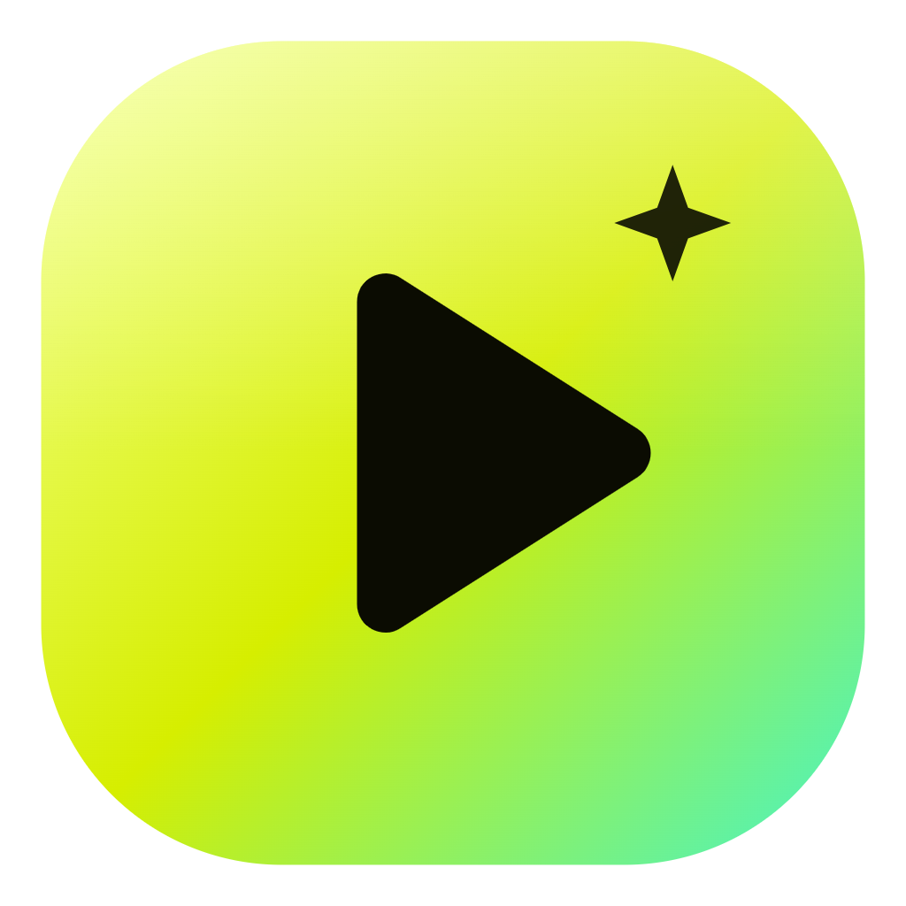

<div align="center">



# Faro — editor de video de escritorio

**Editá, mezclá y terminá tus videos en un solo lugar.** Faro combina una línea de tiempo multipista, herramientas de color, títulos, subtítulos y un estudio multicámara en vivo con asistencia de IA.

[Descargar Faro 1.7.2 para Windows](https://github.com/pauloabrate-prog/faro/releases/latest/download/Faro-Setup-1.7.2.exe) · [Código fuente completo (ZIP)](Faro-Source-1.7.2.zip) · [Ver todos los lanzamientos](https://github.com/pauloabrate-prog/faro/releases)

La landing de Faro está incluida en `landing/index.html` dentro del código fuente.

Windows 10/11 · 64 bits · MIT · Código abierto

</div>

---

Faro es un proyecto independiente mantenido por Paulo Abrate, con identidad y hoja de ruta propias. Su base de edición parte del proyecto de código abierto **Lumen**, de Mas-Inx, distribuido bajo MIT. Faro conserva esa atribución y los avisos de licencia correspondientes; este repositorio reúne las adaptaciones, mejoras y nuevas funciones que construyen Faro.

## Qué podés hacer con Faro

- **Editar en multipista:** organizar video, audio, títulos, subtítulos y efectos en pistas separadas; recortar, mover, ajustar velocidad y animar con keyframes.
- **Mezclar y dar color:** looks, corrección y gradación de color, LUTs `.cube`, transiciones 2D/3D, máscaras, chroma key y títulos 3D.
- **Trabajar con asistencia de IA:** transcribir, crear subtítulos, encontrar pausas, revisar la edición y pedir cambios con modelos compatibles o locales. Las claves de proveedores externos son opcionales.
- **Crear gráficos y recursos:** títulos, lower thirds, estilos de texto, stickers, efectos y guiones gráficos asistidos.
- **Transmitir con Faro Live Studio:** mezclar cámaras A/B/C, hasta tres micrófonos, imágenes, videos y sonidos; usar transiciones, grabar la salida y separar el estudio en una ventana.
- **Exportar el proyecto:** elegir formato y calidad, con codificación por hardware cuando el equipo lo permite.

Faro trabaja con tus archivos locales. Para emitir a plataformas por RTMP(S), instalá una versión compatible de FFmpeg con `libx264`, AAC y RTMPS; Faro no la incluye en el instalador. La disponibilidad de cámaras depende de que el sistema las reconozca como dispositivos de video.

## Instalación

1. Descargá `Faro-Setup-1.7.2.exe` desde [Releases](https://github.com/pauloabrate-prog/faro/releases/latest).
2. Abrí el instalador y elegí si querés instalarlo solo para tu usuario o para todos los usuarios de la PC.
3. Iniciá Faro desde el acceso directo.

El instalador actual es para Windows 10/11 de 64 bits. Si Windows SmartScreen muestra el aviso habitual para una aplicación sin firma de código, revisá que el instalador provenga de la sección Releases de este repositorio.

## Compilar desde el código fuente

Requiere Node.js 24 y npm. En Windows, desde la carpeta del proyecto:

```powershell
npm ci
npm run dev
```

Para generar un instalador de Windows:

```powershell
npm run dist
```

También hay scripts para generar paquetes Linux (`npm run dist:linux`) y macOS (`npm run dist:mac`); los paquetes de macOS deben compilarse en macOS.

## Documentación

- [Faro Live Studio](LIVE-STREAMING.md)
- [Herramientas de IA](docs/AI-TOOLS.md)
- [Grabación de pantalla](docs/RECORDING.md)
- [Integración de frames](docs/INGEST.md)
- [Notas de producto y publicación](PRODUCT-NOTES.md)
- [Avisos de terceros](THIRD-PARTY-NOTICES.md)

## Participar

Las ideas, reportes de errores y contribuciones son bienvenidos. Abrí un [issue](https://github.com/pauloabrate-prog/faro/issues) o consultá [CONTRIBUTING.md](CONTRIBUTING.md).

## Licencia y créditos

El proyecto se distribuye bajo MIT. Se mantiene el aviso de copyright de Mas-Inx para la base Lumen; los aportes específicos de Faro están atribuidos por separado en [`LICENSE`](LICENSE). Las dependencias y sus licencias se detallan en [`THIRD-PARTY-NOTICES.md`](THIRD-PARTY-NOTICES.md).
